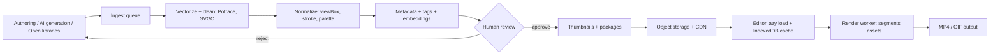

# Asset Pipeline — Thousands of Original Assets, No Artificial Limits

**Date:** 2026-11-21
**Companion document:** `RESEARCH.md`
**Goal:** Produce and deliver thousands of original whiteboard-style assets with consistent, professional quality, so our explainer videos can match the *kind* and *quality* of output seen in the reference app — without copying their proprietary library.

---

## 1. Principles

1. **Original or properly licensed only.** No pulling images, fonts, templates, or icons out of VideoScribe's app, bundles, CDN, or browser cache.
2. **Style over quantity.** A smaller, consistent set looks better than 5,000 mismatched pictures. Every asset must obey the same visual rules.
3. **Everything is data.** Each asset has machine-readable metadata: id, tags, category, style, license, source, attribution.
4. **Generate families, curate individuals.** Use parametric variants and AI to create volume; use humans (or a review queue) to keep quality high.
5. **Deliver lazily.** Ship manifests and thumbnails first; fetch full assets only when used; cache locally like the reference app does with its IndexedDB `assetDatabase`.
6. **No product ceilings.** No "3 downloads left", no forced watermark, no arbitrary 5-minute cap. Real limits are storage/compute budgets, not user-facing walls.

---

## 2. Pipeline overview



---

## 3. Authoring sources (allowed)

| Source | License notes | Best for |
|---|---|---|
| Our own SVGs (Figma, Inkscape, Illustrator) | Fully ours | Core characters, recurring motifs |
| AI-generated originals + vectorization | Check generator terms; keep prompts | Bulk concepts, scenes, backgrounds |
| Lucide, Tabler Icons, Font Awesome Free | ISC / MIT / CC BY (check each) | Clean interface/object icons |
| OpenMoji (CC BY-SA 4.0), Twemoji (CC BY 4.0) | Attribution required | Friendly pictorial symbols |
| Kenney (CC0), Openclipart, Wikimedia Commons | Mostly public domain; verify per file | Simple drawings, texture elements |
| unDraw, SVG Repo | Custom/mixed licenses — read before commercial use | Decorative illustration |
| Noun Project | Free with attribution or paid | Hand-style icon library |
| Google Fonts handwriting families (OFL) | Open Font License | Caveat, Kalam, Patrick Hand, Indie Flower, Permanent Marker |
| YouTube Audio Library, Pixabay Music, Free Music Archive | Per-track license | Royalty-free music loops |
| SpeechSynthesis or licensed TTS | Check voice license | Voiceover |

**Never:** copy VideoScribe's own art, cursors, templates, handwriting font files, or branding. Do not treat "it's in the browser cache" as permission.

---

## 4. Making thousands without drawing thousands

### 4.1 Parametric families

Start with a base SVG whose colours, shapes, and accessories are variables:

```
person-base.svg  ×  8 hairstyles × 6 outfits × 5 skin tones = 240 people
icon-base.svg    ×  6 stroke styles × 4 palettes          = 144 variants
```

A few dozen base drawings can yield 1,000+ distinct, coherent assets.

### 4.2 Style variants

For each approved base drawing, render variants:

- outline only / lightly filled / filled;
- black ink / two-tone / accent colour;
- thin / regular / bold stroke;
- with or without hand-drawn wobble (rough.js seed).

### 4.3 AI batch + vectorize

1. Generate originals in batches using consistent prompts and palette constraints.
2. Raster → vector with Potrace or a vectorizer service.
3. Auto-clean paths with SVGO; remove stray pixels and metadata.
4. Route to review queue. Only approved items enter the catalog.

### 4.4 Community contributions

Accept original submissions with an explicit contributor license agreement that grants us the right to ship and sublicense the art. Record contributor attribution in the manifest.

---

## 5. Normalization rules (the "same quality" recipe)

Every approved SVG must satisfy:

- viewBox `0 0 512 512` (or documented aspect variant);
- transparent background unless explicitly a background asset;
- stroke width in a narrow band (e.g. 2–4 px at 512) — consistency matters more than style;
- rounded line caps/joins for a hand-drawn feel;
- palette limited to the active theme (ink, paper, 2–4 accents);
- no embedded raster images, no external references, no scripts;
- optimized with SVGO; target < 20 KB for simple icons;
- 140 px PNG/SVG thumbnail generated (matches the reference app's `THUMB_SIZE = 140`);
- license, source, and attribution recorded.

Optional but recommended:

- a `hand-drawn` path with a stable animation order for stroke drawing;
- anchor metadata for camera push-ins (where the "eye" should focus).

---

## 6. Catalog layout and manifest

```
public/assets/
  people/
    teacher.svg
    doctor.svg
  objects/
    laptop.svg
    lightbulb.svg
  backgrounds/
    whiteboard.svg
    paper.svg
  hands/
    point.svg
    write.svg
  fonts/
    caveat.woff2
  audio/
    calm-loop.mp3
  manifest/
    people.json
    objects.json
    backgrounds.json
    hands.json
    fonts.json
    audio.json
```

Each manifest is sharded by category so the editor fetches only what the drawer needs (the reference app uses 30 items per page for image search — a sensible default for us too).

Example entry:

```json
{
  "id": "objects-lightbulb-v2",
  "path": "/assets/objects/lightbulb.svg",
  "thumbnail": "/assets/objects/thumbs/lightbulb-140.png",
  "category": "objects",
  "tags": ["idea", "lightbulb", "thinking", "innovation"],
  "style": ["outline", "hand-drawn"],
  "palette": ["ink", "accent-yellow"],
  "license": "CC0",
  "source": "original",
  "attribution": "",
  "approvedBy": "reviewer-name",
  "version": 2,
  "aspect": "1:1",
  "animatedStroke": true
}
```

---

## 7. Search and discovery

- Start with tag/category filters and full-text search over metadata.
- Add embedding-based search (CLIP-style vectors stored in pgvector/Qdrant) for natural queries like "happy teacher pointing at a chart".
- Keep a synonym map so "bulb", "idea", and "lightbulb" converge.
- Track usage counts so popular assets surface first.

---

## 8. Storage and delivery

- Store originals and generated packages in object storage (S3 / Cloudflare R2 / equivalent).
- Serve through a CDN with long cache lifetimes and versioned URLs.
- Generate signed URLs for private/premium assets (same *shape* as the reference app's `GET /project-assets?assetIds=...`, independently implemented).
- Editor flow: manifest → thumbnails → full SVG on demand → IndexedDB cache keyed by asset id + version.
- Invalidate by version, not by overwriting files.

---

## 9. Render factory (so "no limits" actually works)

The reference app sends `segments + assets + format` to `/render`, polls `/progress`, then fetches `/download-url`. We can implement the same contract ourselves:

1. Client freezes project into a deterministic render manifest.
2. Job queue (BullMQ / SQS / similar) receives the job.
3. Stateless workers draw frames (canvas/Pixi or Remotion) and encode with FFmpeg.
4. Progress is written to a small status store and polled by the UI.
5. Finished file goes to object storage; a signed download URL is returned.

Scaling notes:

- workers autoscale on queue depth;
- cap per-job cost internally (timeouts, max resolution, abuse controls) rather than showing arbitrary user quotas;
- 1080p/30 fps default; optional 60 fps / 4K as a paid or configurable tier;
- no watermark by default in our product.

---

## 10. Quality gate checklist (per asset)

- [ ] Original or license recorded with attribution
- [ ] Passes normalization rules in §5
- [ ] SVGO-clean, no external refs
- [ ] Thumbnail generated
- [ ] Tags + category + style filled
- [ ] Human-approved (or explicitly marked auto-approved with confidence score)
- [ ] Tested in one sample render at 1080p
- [ ] Version incremented if changed

---

## 11. Scale roadmap

| Phase | Catalog size | Focus |
|---|---|---|
| 0 | 30–50 | Prove the pipeline: 5 base drawings × variants, manifests, review, render test |
| 1 | 200 | Fill core categories; add embedding search; define the style guide formally |
| 2 | 1,000 | Parametric generators + AI batches + contributor flow |
| 3 | 5,000+ | Community contributions, automated QA, CDN sharding, analytics-driven curation |

Remember: reaching 5,000 is mostly a **content operations** effort. Coding the pipeline is the easy half.

---

## 12. Legal / ethical guardrails

- Do not scrape or redistribute the reference product's assets, fonts, templates, or source code.
- Do not reuse their name, logo, or trade dress in our product.
- Honour every upstream license (attribution, share-alike, commercial restrictions).
- Keep a license ledger in the repo so every shipped asset is auditable.
- When in doubt, generate it ourselves.

---

## 13. Open decisions

1. Final art direction: pure black-line-on-white, or accent-colour "modern whiteboard"?
2. Storage/CDN provider and monthly budget.
3. Whether to include AI voiceover/music generation (and which vendor licenses).
4. Whether contributions are accepted, and under what CLA.
5. Default export settings (1080p/30 fps) and whether 4K is offered.

---

## 14. First concrete task — implemented

`tools/generate-variants/` is in place. It takes 5 original base SVG drawings and produces **50 variants** with:

- full SVG assets and 140px thumbnails under `public/assets/`,
- sharded manifests plus `all.json` following the schema in §6,
- a visual `public/assets/contact-sheet.html` for review,
- a `--check` mode that verifies files and placeholder removal.

Run it with `node tools/generate-variants/generate.mjs`. This proves the variant-generation half of the pipeline; the remaining work is increasing the number of *base* drawings and adding the review/search layers.
