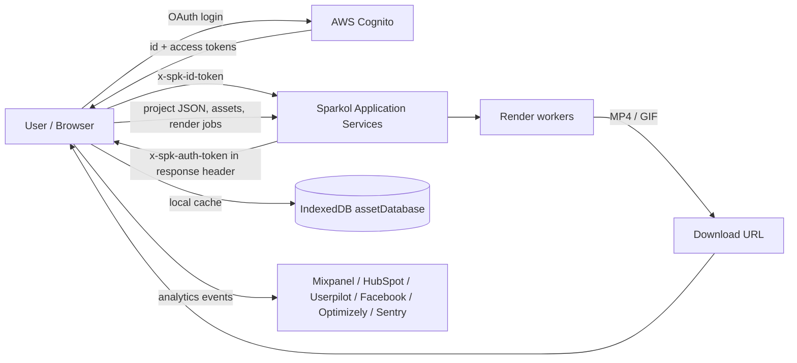

# VideoScribe Cloud — Reverse Engineering Research

**Date:** 2026-11-21
**Target:** `https://www.videoscribe.co/app/` (logged-in VideoScribe Cloud)
**Purpose:** Understand how the reference product works so we can build an original whiteboard explainer maker with equivalent *behaviour* and *output quality*, without copying proprietary code or art.

> Scope note: this is a behavioural/architectural study. No private tokens, credentials, or proprietary assets were retained. Findings come from published browser bundles/source maps and from observing a logged-in session with our own test project.

---

## 1. How the research was done

| Method | What it gave us |
|---|---|
| REA `analyze-web-bundle` + published source maps | Original TypeScript/JavaScript source layout, config, API clients, permission rules, Redux state |
| REA `observe_web_session` against CDP Chrome | Navigation metadata for the real logged-in session |
| Direct CDP network logging (our own script) | Actual request URLs, methods, and HTTP statuses during save and export |
| Live UI automation through CDP | Real project creation, editing, saving, preview link modal, MP4 render, and download |

### Evidence IDs / artifacts

- Target list: `ev_2aeebee398a6d10e692c37273bad0acca248693fcf18c4739f47c2f8c751bf20`
- Page inspection: `ev_f0ce3d71713f3d6e7a9ecf7bf5ccdba11bb4b2430398bdfa47066b0f48df1ad4`
- Bundle summary: `ev_02b4b3aed16b3d2d8cca110ac3b59dc7c1e27334da779c44a5f7809abf606a74`
- Retained full bundle analysis: `ev_186a568b515f9a6b257d9fd517eee1dd97bc343d1f5b024b09669678dd013e51`
- Routes/permissions analysis: `ev_baf8267a4f4da8a5711ef0251e37174dd17bcee2d7edd6fd1468e500ca3e786c`
- Observation 1 (create project): `ev_67df73eb2ec112d3923d3251ee1d650552de76fb6c5b4a90dac77f50f7a6`
- Observation 2 (editor window): `ev_eca07aa1aa0dc1dbfcf05a3e1dc42c3aab57fda58d44858ea58f06e28f77c1f7`
- Live network log: `%LOCALAPPDATA%\Temp\opencode\videoscribe-network.jsonl`
- Extracted original sources: `%LOCALAPPDATA%\Temp\opencode\videoscribe-sources`

### Tool limitations (important)

- REA's `observe_web_session` retains **navigation metadata only**. It explicitly does not capture headers, bodies, cookies, console values, or payloads.
- Our CDP netlog recorded request URLs/methods and response statuses plus header *names*; it did not record header values or bodies. An attempt to capture bodies attached after all Sparkol calls had completed, so no bodies were available.
- Server-side implementation (Sparkol's render farm, asset store, entitlement service) is invisible from the browser. We can describe its contract, not its internals.

---

## 2. High-level architecture

### Observed stack

- React + Redux/Redux-Saga (source maps show action creators, reducers, sagas).
- PixiJS for the drawing canvas (`lower-canvas` / `upper-canvas` DOM elements), Fabric among dependencies.
- Dexie/IndexedDB for a local asset cache named `assetDatabase`.
- AWS Amplify / Cognito for identity; region `us-east-1`.
- `services.sparkol.com` as the application-services base URL in production.
- Vite-style `import.meta.env` configuration.

### Production configuration discovered

| Key | Value |
|---|---|
| `APPLICATION_SERVICES_URL` | `https://services.sparkol.com` |
| `APPLICATION_NAME` | `videoscribe-cloud` |
| `COGNITO_CLIENT_ID` | `4a27aq0l11jk054npfdidal23s` |
| `COGNITO_USER_POOL` | `us-east-1_xcYZVND5A` |
| `AWS_REGION` | `us-east-1` |
| OAuth domain | `auth.videoscribe.co` |
| Thumbnail size | `140` px |

The checked-in config defaults point at test endpoints; production values are supplied through environment variables at build time.

---

## 3. Authentication and session flow

1. Login is handled by Cognito Hosted UI on `auth.videoscribe.co`.
2. Tokens are stored in `localStorage` under:
   `CognitoIdentityServiceProvider.<clientId>.<userId>.{accessToken,idToken,refreshToken,userData,clockDrift}` plus a `LastAuthUser` key. Token values were redacted and are not retained.
3. The app calls `POST {base}session` with an `x-spk-id-token` header.
4. Sparkol replies with an `x-spk-auth-token` header and TTL; the app uses this service token for subsequent calls.
5. `DELETE {base}session` logs out.

`fetchWithReAuth` wraps service calls: it retries after re-authentication and rate-limits requests (`SERVICES_REQUEST_RATE_LIMIT = 6`, `SERVICES_REQUEST_CONCURRENCY = 2`).

---

## 4. Routes and user flow (observed)

| Route | Purpose |
|---|---|
| `/app/` | Project list / templates / trial banner |
| `/app/new-project/` | Name + aspect ratio (16:9, 1:1, 9:16) |
| `/app/editor/:id/` | Main editor with timeline, canvas, asset drawers |
| `/app/editor/:id/share/` | "Share your video" modal — preview link or download |
| `/app/editor/:id/download/` | Download modal — MP4 or GIF, download allowance |

Editor panels observed: Download, Script, Scenes, Music, Voiceover, Text, Image, Shape, Camera, Settings.

Free-trial limits displayed: 25 scenes, 150 image elements, 50 audio tracks, 300 MB audio, 5:00 duration. Trial banner showed ~6 days remaining and "3 of your 3 downloads remaining" before rendering.

---

## 5. API surface reconstructed from source maps

Base: `https://services.sparkol.com/`. CORS preflight `OPTIONS` precedes most cross-origin writes.

### Session / user

| Method | Path | Notes |
|---|---|---|
| `POST` | `/session` | Exchange Cognito id token for Sparkol token |
| `DELETE` | `/session` | Logout |
| `GET` | `/user/{uid}/app-data/videoscribe-cloud/{key}` | User settings (e.g. custom colors) |
| `PUT` | `/user/{uid}/app-data/videoscribe-cloud/{key}` | Save settings |
| `GET` | `/user/{uid}/downloads` | Download history |
| `GET` | `/limits` | Current entitlements/limits |
| `GET`/`POST` | `/user/{uid}/config/accepted-terms` | Terms state |
| `POST` | `/user/{uid}/accept-marketing` | Marketing opt-in |

### Projects

| Method | Path | Notes |
|---|---|---|
| `GET` | `/user/{uid}/projects/videoscribe-cloud` | Project list |
| `POST` | `/project-data` | Create (`title`, `appName`, `projectModel`) |
| `GET` | `/project-data/{id}` | Load project + ETag |
| `PUT` | `/project-data/{id}` | Save with `If-Match: <etag>` (optimistic concurrency) |
| `DELETE` | `/project-data/{id}` | Delete |
| `POST` | `/project-data/duplicate/{id}` | Duplicate |
| `GET`/`PUT` | `/project-data/{id}/activity` | Active-seconds tracking |
| `POST` | `/project-data/from-template/{templateId}` | Create from template |
| `POST` | `/template/from-project/{projectId}` | Save as template |
| `GET` | `/share-project/{publicSharingId}` | Public preview |
| `PUT` | `/share-project/{projectId}` | Create preview link |

### Assets / library

| Method | Path | Notes |
|---|---|---|
| `POST`/`DELETE` | `/project-asset` / `/project-asset/{id}` | Upload/delete |
| `GET` | `/project-asset?type=...` | List by type (`image`, `font`, audio) |
| `GET` | `/project-assets/paged?type=image&sort&offset&limit&source&search` | Paged image search (30 per page) |
| `GET` | `/project-assets?assetIds=...` | Signed URLs |
| `POST` | `/project-asset/{id}/thumbnail` | Upload thumbnail |
| `PATCH` | `/project-asset/{id}` | Update metadata |
| `GET` | `/library/hands?results=1000` | Hand/cursor assets |
| `GET` | `/library/music` | Music library |
| `POST` | `/project-asset` | Create asset from external library (e.g. Noun Project) |

### Rendering

| Method | Path | Notes |
|---|---|---|
| `POST` | `/render` | Start render; body includes `application`, `segments`, `assets`, `source`, `applicationUrl`, `visibility`, `format`, `videoDuration` |
| `POST` | `/render` with `{source, cacheOnly:true}` | Cached render |
| `DELETE` | `/render/{shortId}` | Abort |
| `GET` | `/render/{shortId}/progress` | Poll status |
| `GET` | `/render/{shortId}/download-url` | Final file URL |
| `GET` | `/user/{rendererUid}?projectId=...` | Renderer user context |

### AI features

`POST /image-generator/execute` + `GET /image-generator/execution/{id}/status`,
`POST /voiceover-generator/execute` + `GET /voiceover-generator/execution/{id}`,
`POST /script-generator/execute` + `GET /script-generator/execution/{id}`.

### Analytics/telemetry observed in network log

Google Fonts, Userpilot uploads, Facebook pixel, HubSpot forms, a VideoScribe asset PNG, and `POST https://api-eu.mixpanel.com/track/`.

---

## 6. Live session: what actually happened

Test project created: **REA Probe Project**, id `3387958`.

| # | Action | Request | Status |
|---|---|---|---|
| 1 | Add rectangle + Ctrl+S | `OPTIONS` then `PUT /project-data/3387958` | 204, 200 |
| 2 | Editor activity | `GET /project-data/3387958/activity` (twice) | 200 |
| 3 | Open Download → share modal | no service call; UI derived from loaded state | — |
| 4 | MP4 → Start download | `OPTIONS` then `POST /render` | 204, 200 |
| 5 | Poll render | `GET /render/73317d1a8ea045cfaa8588fb547a7697/progress` (twice, with preflights) | 200 |
| 6 | Get file | `GET /render/{id}/download-url` | 200 |
| 7 | Refresh allowances | `GET /limits` | 200 |

Result: `C:\Users\user\Downloads\REA Probe Project.mp4` (379,490 bytes), watermarked free-trial output. One of three downloads was consumed.

**Conclusion:** the live sequence matches the source-map-derived contract exactly: `renderCloud()` → `fetchRenderProgress()` → `getVideoDownloadUrl()` → `getLimits()`.

---

## 7. Entitlements / rule book

From `src/js/permissions/permissions.ts`, roles are `FREE`, `PRO`, `PLUS`, `EDU`, `LITE`, `CORE`, `MAX` and scopes include:

`createPreviewLink`, `playbackPremiumContentWithoutWatermarks`, `useAiGenerations`, `searchNounProject`, `addCustomFont`, `create10mVideo`, `create15mVideo`, `create20mVideo`, `usePremiumContent`, `downloadPremiumContent`, `setDefaultSettings`, `migrateLegacyProject`, `useBrandKit`.

- `FREE`: preview link, watermark-free *playback* of premium content, AI generations.
- `MAX`: adds 20-minute video, custom fonts, Brand Kit, premium content.
- `EDU`/`CORE`/`PLUS`/`PRO` sit in between.

Our product can implement its own rules; we should not reproduce their pricing/branding.

---

## 8. Rendering / output quality clues

- Editor canvas is a PixiJS pair of canvases; export sends **segments + assets** to the render service, not a screen recording.
- Output formats: MP4 (full length, full colour, audio) and GIF (first 15 seconds).
- Render is asynchronous with a short id, progress polling, then a download URL.
- The "hand-drawn" look comes from animated SVG-style strokes, a hand/cursor asset, easing, consistent line weight, and a paper-like background — techniques we can recreate independently.

---

## 9. What we can and cannot reproduce

| Can reproduce (behaviour/architecture) | Cannot see or copy (limits) |
|---|---|
| React + canvas editor, scenes/timeline model, hand-drawn stroke animation | Sparkol server internals and render-farm implementation |
| Save/load with revision checks, asset cache, signed URLs | Private tokens/credentials (intentionally not retained) |
| Auth-by-token exchange pattern (our own identity provider) | Their proprietary images, templates, fonts, trademark, branding |
| Render queue → progress → download URL API shape | Minified third-party internals; pixel-identical animation math |
| Entitlement model with our own tiers and no arbitrary download quotas | Years of hidden edge-case fixes |

**Goal:** equivalent *capability* and *quality*, built originally. Not a clone of their code or catalog.

---

## 10. Definition of Done for our first milestone

A user can:

1. Create a project with a chosen aspect ratio.
2. Add a shape/text/image and see it draw itself on the canvas.
3. Save, reload the page, and see the same project.
4. Preview the scene timeline.
5. Export a playable 1080p MP4 with no watermark and no download quota.
6. Inspect a manifest entry proving every asset used is original or correctly licensed.

---

## 11. Recommended build order

1. **Core model + editor shell** — projects, scenes, elements, timeline state.
2. **Drawing engine** — SVG path animation (`stroke-dashoffset`), rough.js wobble, hand cursor, easing.
3. **Persistence** — local IndexedDB cache + optional backend with ETag-style revision checks.
4. **Render pipeline** — queue → worker → FFmpeg/Remotion → progress → download URL.
5. **Asset factory** — see `ASSET_PIPELINE.md`.
6. **Entitlements/accounts** — only if needed; default to no artificial limits.

---

## 12. Side effects of this research (for awareness)

- Test project `REA Probe Project` (`3387958`) still exists in the account.
- One free download was consumed; MP4 saved locally as above.
- No repository changes were made before this document.
